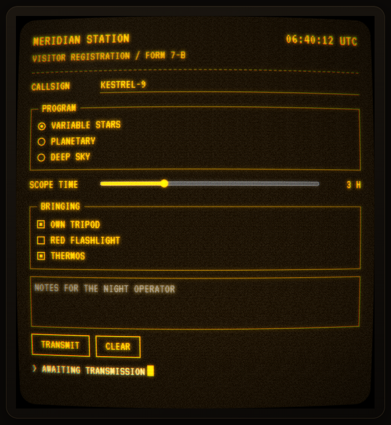
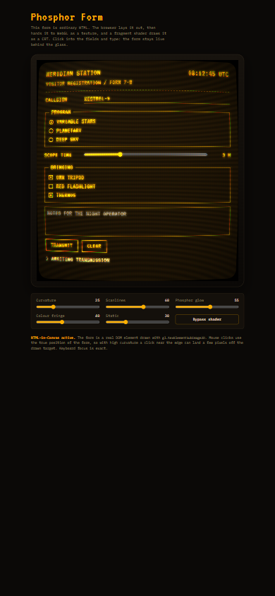
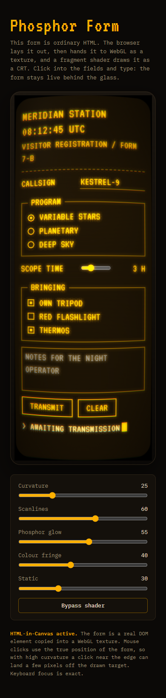
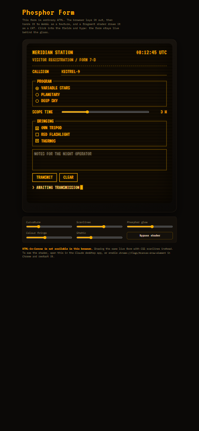
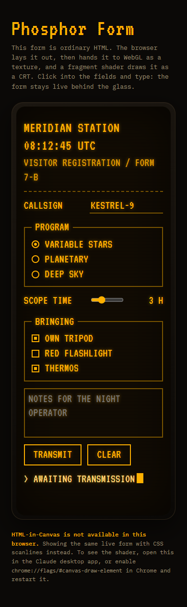

# Phosphor Form: an HTML-in-Canvas demo

A live HTML form, drawn into a WebGL canvas through a CRT shader. You can still click into the fields and type.

[](https://az9713.github.io/claude-html-in-canvas-demo/phosphor-form.html)

**[Open the live demo](https://az9713.github.io/claude-html-in-canvas-demo/phosphor-form.html)** · **[Read the explainer](https://az9713.github.io/claude-html-in-canvas-demo/)** · **[Compare mobile screenshots](#what-changed-on-screen)**

GitHub does not run scripts or iframes in a README. The screenshot above links to the live page, and the explainer page embeds the live demo.

## Canvas Workbench

[Search and filter the 40-project gallery](https://az9713.github.io/claude-html-in-canvas-demo/#workbench-gallery).

### HTML-in-Canvas feature atlas

[Open the five live experiments](https://az9713.github.io/claude-html-in-canvas-demo/live/atlas/). Each uses a different part of the [WICG proposal](https://github.com/WICG/html-in-canvas#proposed-solution).

| Experiment | What to check |
| --- | --- |
| [Worker rendering](https://az9713.github.io/claude-html-in-canvas-demo/live/atlas/#worker) | Type into a dispatch label drawn by a worker and export the proof sheet. |
| [Nested layers](https://az9713.github.io/claude-html-in-canvas-demo/live/atlas/#nested) | Reposition a sign-off independently of its parent document and inspect the parent paint. |
| [Selective repaint](https://az9713.github.io/claude-html-in-canvas-demo/live/atlas/#dirty) | Update a dock card and check which HTML captures the browser invalidates. |
| [Hit-test clipping](https://az9713.github.io/claude-html-in-canvas-demo/live/atlas/#geometry) | Click the same spot as the application changes hit-test order and clipping. |
| [WebGPU compute](https://az9713.github.io/claude-html-in-canvas-demo/live/atlas/#compute) | Edit a label and measure its painted ink coverage in a GPU compute pass. |

The atlas uses synthetic samples and browser APIs. Each experiment reports which native features are available. Serve `docs/` on localhost to try the worker example locally.

### Second batch of 40 live demos

[Open Live Canvas Lab](https://az9713.github.io/claude-html-in-canvas-demo/live/batch-two/). The second batch uses real browser-painted HTML controls for pixel inspection, spatial interfaces, publication proofs, and visual verification. Each project has a task to try and explains what HTML-in-Canvas contributes. Examples include a rendered contrast meter, a folded leaflet proof, a bidirectional typesetting proof, and a scanline test of a scaled label.

Open [`docs/live/batch-two/index.html`](docs/live/batch-two/index.html) for local use. The lab uses synthetic examples, plain JavaScript, browser APIs, and local CSS. It requires no packages, external assets, accounts, or API calls.

### Live WebGL labs

- [Live layout diff](https://az9713.github.io/claude-html-in-canvas-demo/live/layout.html). Edit either version of the same form, then use Pixel diff to see where a CSS change moves the browser-painted controls.
- [3D control panel](https://az9713.github.io/claude-html-in-canvas-demo/live/panel.html). Turn a simulated device and operate its native HTML controls on the projected surface. Save the combined WebGL view as a PNG.

The labs have plain HTML fallbacks. Each gallery card also has a **Try here** button that opens the running project inline.

### Run the workbench locally

Open [`docs/workbench/index.html`](docs/workbench/index.html) directly in a local browser to use 40 projects for learning, science, research, software, media, and practical planning. The workbench runs from the files in this repository. It needs no server, package install, account, or API key.

1. Choose a project. Each opens with synthetic sample data and instructions for its inputs.
2. Change the inputs or add local files. Pick an annotation from the menu or place a pin on the scene. Use Zoom and Pan to inspect a region.
3. Freeze a reference before changing a parameter. Compatible plots overlay that reference. The results panel also preserves its measurements.
4. Save a PNG for sharing or save a JSON session to continue later. A session includes its imported files, notes, and any files used by a frozen reference. Save it before reloading or closing the workbench.

Chrome with Canvas 2D HTML-in-Canvas support draws the editable annotation directly into the scene. The plain view puts the same editor above the canvas, with the same project controls and local export. Video tools use local frames in browser-supported formats. Where WebM recording is available, it records the visual canvas.

## Inspiration

[Felix Rieseberg](https://x.com/felixrieseberg) posted on 15 November 2026: "All hail the weird web. I just enabled HTML-in-Canvas in Claude's desktop apps." He shared demos made with it and compared the feel to the Flash days. This repo is a small experiment built from that idea.

## What is HTML in Canvas?

HTML in Canvas is a proposed browser feature ([WICG proposal](https://github.com/WICG/html-in-canvas)). It lets a page draw a live HTML element into a `<canvas>` and use the result as pixels. The canvas can then draw it, warp it, or feed it to a shader.

In this demo:

| Piece of the proposal | Where it is in `docs/phosphor-form.html` |
|---|---|
| `content="drawable"` on the canvas | `<canvas id="crt">` |
| `drawable` on the form | `<form id="form">` |
| `paint` event, `requestPaint()` | The canvas listener calls `paint()`. `fit()` requests a paint after sizing the canvas. |
| `texElementSubImage2D` (WebGL draw call) | First texture upload strategy in `startShader()` |
| `updateElementGeometry` (hit testing) | `paint()` |

The form is real DOM. The browser handles the caret, focus, radio buttons, checkboxes, range slider, and textarea. The page contains no code that draws a text field. The browser's own renderer makes the pixels, and the fragment shader (`FS`) curves them, splits the colour channels, and adds glow, scanlines, and static.

The [explainer](https://az9713.github.io/claude-html-in-canvas-demo/) covers this in full: the five pieces, a diagram of how a keystroke reaches the shader, what does not count as HTML in Canvas, and the API problems found while building it.

## Ideas and projects to build

These are ideas, not tested projects. Each one uses a capability the proposal gives: real DOM content drawn as pixels, which a shader or a 3D scene can then change. The WICG repo already has examples for some of them (`complex-text`, `pie-chart`, `nested-sparkles`, a WebGL card flip, and a WebGPU "jelly slider"). They are in its [Examples folder](https://github.com/WICG/html-in-canvas/tree/main/Examples).

**Shader-skinned interfaces** (the idea behind this demo)
- **Liquid glass and frosted panels.** Draw a settings panel as a texture, then blur and refract whatever is behind it. The controls stay real.
- **Click ripples and glitch transitions.** Distort the form around the pointer when a button is pressed.
- **Other screens.** A vector monitor, a Game Boy LCD with a pixel grid, an e-ink page that ghosts when it changes, a thermal-printer receipt.

**Real UI on 3D surfaces**
- **A working laptop or arcade cabinet in a 3D scene.** The screen is a mesh. Its texture is a live form, a chat, or a spreadsheet. Keyboard focus and `updateElementGeometry` give the clicks a place to land.
- **A book with page curl.** Each page is a drawable element with real text, links, and inputs. The curl is a vertex shader.
- **A museum room.** Each painting on the wall is an HTML card you can walk up to and use.

**Page transitions**
- **Shatter, dissolve, or fold between two pages.** Capture both pages as textures and mix them in a shader. Neither page needs to be a screenshot.

**Rich text and charts in canvas**
- **Text on a spiral, a globe, or a wave.** The browser does the shaping, so right-to-left scripts, emoji, and line breaks stay correct.
- **Charts with real HTML labels.** Multi-line, wrapped labels in a pie or Sankey chart, drawn by the canvas but laid out by CSS.

**Games**
- **Dialogue boxes, inventories, and name-entry screens** that use real inputs, and still sit inside the game's post-processing (bloom, bend, film grain).

**Export**
- **HTML to PNG or video.** Render an invoice, a certificate, or a social card as HTML, draw it to a canvas, then call `toBlob()` or record the canvas with `MediaRecorder`. An animated HTML title card becomes a video file.

**Worker rendering**
- **Heavy effects off the main thread.** The proposal lets a page pass an `ElementImage` to a worker that draws into an `OffscreenCanvas`. A particle burst over a form could then run without slowing typing.

**Accessibility experiments**
- **Canvas apps that screen readers can read.** The content is real DOM, so the accessibility tree can hold the labels. The proposal says geometry must be set (with `updateElementGeometry`) for assistive tools to place the content.

**The weird web**
- **A site that is one canvas.** A navigation you fly through, a desktop with draggable windows, a zine whose pages react to the mouse. This is the Flash-era feel that Felix Rieseberg's post described, with real links and inputs instead of a plugin.

## See the shader

The shader needs a browser with HTML-in-Canvas turned on:

- **Chrome:** open `chrome://flags/#canvas-draw-element`, set it to Enabled, and restart.
- **Claude desktop app:** Felix Rieseberg's post says the feature is enabled there. I tested only in a separate Chrome, not in the app.

## What changed on screen

- On phones, the page opens at normal zoom and fits the screen width. The station header and form buttons can wrap on narrow screens, and the shader settings stack as space gets tight.
- In CSS fallback, the amber form and scanlines remain visible, and the shader settings are hidden. If the shader fails to start, the page switches to that same form and displays the reason.
- In shader mode, the settings appear after the first successful frame. The amber glow, curvature, and scanline effects retain their original look.

All four screenshots use the same 390 × 844 mobile viewport in Chrome 157. Chrome scaled the original page to about 40%, so all of it fit in one screen. The fixed page opens at 100%. The after images include the full scrollable page to show what appears below the form.

### WebGL shader

<table>
  <tr><th>Before</th><th>After</th></tr>
  <tr>
    <td valign="top"></td>
    <td valign="top"></td>
  </tr>
</table>

### CSS fallback

<table>
  <tr><th>Before</th><th>After</th></tr>
  <tr>
    <td valign="top"></td>
    <td valign="top"></td>
  </tr>
</table>

## Run it locally

No build step. One HTML file.

```bash
cd docs
python -m http.server 8000
```

Then open `http://localhost:8000/phosphor-form.html`.

## Files

| Path | Content |
|---|---|
| `docs/phosphor-form.html` | The demo (HTML, CSS, JavaScript, and the GLSL shader in one file) |
| `docs/index.html` | The explainer page |
| `docs/screenshot.png` | Screenshot of the shader path |

GitHub Pages serves only the `docs/` folder.

## Status and known issues

- HTML-in-Canvas is a proposal. Call names changed while this demo was built (`texElementImage2D` became `texElementSubImage2D`). The demo tries three call forms and keeps the first that works.
- Verified in headless Chrome 157 at 900 px desktop width and 390 px emulated mobile width. Both rendering paths accepted form input and submission. Shader settings and Bypass worked in the shader path. At 320 px, both paths fit the viewport.
- Mobile verification used Chrome touch emulation. Other browsers and physical mobile devices remain unverified.
- One report: in the Claude desktop app viewer, the CALLSIGN field accepted only 4 letters. It did not reproduce in Chrome 157. The cause is unknown.
- At high curvature, a click near the edge can land a few pixels off the drawn target. The browser hit-tests the form at its layout position. Keyboard focus is exact.
